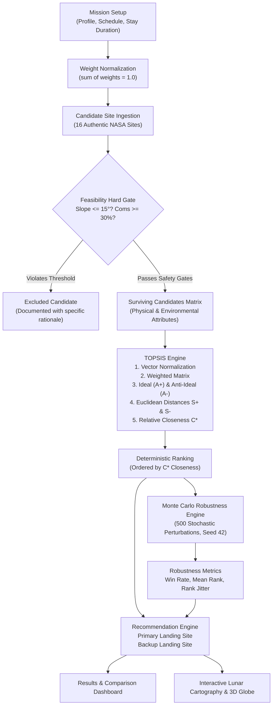

# LunarNavi 🌔

> **Mission-Aware Lunar South-Pole Landing Site Multi-Criteria Decision Support Platform**

### 🚀 Live Demo: [https://lunarnavi.onrender.com](https://lunarnavi.onrender.com)

[](https://lunarnavi.onrender.com)
[](https://lunarnavi.onrender.com/#robustness)

[-success?style=flat-square)](file:///tests/)
[](file:///package.json)
[](file:///package.json)
[](file:///package.json)
[](file:///supabase/)
[](https://lunarnavi.onrender.com)

LunarNavi is an advanced, mission-aware decision support system engineered for lunar exploration missions (including NASA Artemis III candidate evaluations). Built with authentic NASA planetary datasets, it couples a feasibility hard-gate filter, a vector-normalized **TOPSIS** (Technique for Order Preference by Similarity to Ideal Solution) multi-criteria ranking engine, and a 500-trial stochastic **Monte Carlo** robustness simulation to evaluate candidate landing sites across the lunar south pole ($84^\circ\text{S} - 90^\circ\text{S}$).

The platform automatically computes both a **Primary Landing Site** and a scientifically complementary, safe **Backup Landing Site**, enabling mission planners, systems engineers, and scientists to understand trade-offs with mathematical rigor and transparency.

> [!NOTE]
> **Decision Support Prototype**: LunarNavi provides analytical decision-support, sensitivity analysis, and trade-off exploration. It is designed for preliminary mission planning and trade studies, not autonomous real-time flight guidance or flight safety certification.

---

## 📑 Table of Contents

1. [Project Overview](#-project-overview)
2. [Problem Statement](#-problem-statement)
3. [Our Solution](#-our-solution)
4. [Key Features](#-key-features)
5. [How LunarNavi Works](#-how-lunarnavi-works)
6. [System Architecture](#-system-architecture)
7. [TOPSIS Multi-Criteria Decision Analysis](#-topsis-multi-criteria-decision-analysis)
8. [Monte Carlo Robustness Simulation](#-monte-carlo-robustness-simulation)
9. [Primary Site vs. Backup Site Selection](#-primary-site-vs-backup-site-selection)
10. [Scientific Data Sources](#-scientific-data-sources)
11. [Technology Stack](#-technology-stack)
12. [Project Structure](#-project-structure)
13. [Database Architecture (Supabase)](#-database-architecture-supabase)
14. [Setup and Local Installation](#-setup-and-local-installation)
15. [Environment Variables](#-environment-variables)
16. [Live Deployment & Configuration](#-live-deployment--configuration)
17. [Scientific & Analytical Limitations](#-scientific--analytical-limitations)
18. [Contributors](#-contributors)
19. [Acknowledgements](#-acknowledgements)

---

## 🔭 Project Overview

The lunar south pole is humanity's highest-priority destination for near-term lunar surface exploration. Permanently Shadowed Regions (PSRs) act as ultra-cold thermal traps preserving volatile water-ice deposits, while adjacent crater rims and elevated massifs receive extended periods of solar illumination and direct line-of-sight visibility to Earth.

However, selecting an optimal landing site requires navigating severe physical conflicts:
- Maximizing solar power requires high ridge elevations, which frequently have hazardous terrain slopes.
- Accessing water-ice resources requires entering cryogenic, steep crater interiors ($T < 40\text{ K}$) that receive zero direct sunlight and no direct Earth communication.
- Crew and rover operations require gentle slopes ($< 8^\circ$) and minimal surface roughness to prevent touchdown tipping and mobility entrapment.

**LunarNavi** eliminates subjective, manual landing site selection by providing a reproducible, mathematically grounded platform where mission parameters directly dictate site feasibility, ranking, and sensitivity verification.

---

## ⚠️ Problem Statement

Mission architects evaluating landing zones at the lunar south pole face several interconnected challenges:

1. **Multi-Objective Conflict**: Landing safety (low slope and low RMS roughness) directly conflicts with resource exploration (proximity to deep, steep-walled PSRs). Single-attribute scoring fails to capture non-linear trade-offs.
2. **Measurement Uncertainty**: Planetary remote sensing datasets have intrinsic sensor noise, interpolation variance, and spatial resolution limits (e.g., 20 m/pixel LOLA DEMs cannot resolve sub-meter boulder fields). Deterministic rankings that ignore error margins produce brittle decisions.
3. **Mission Diversity**: A science mission (focused on South Pole-Aitken basin impact melt sampling), a resource mission (focused on epithermal neutron hydrogen detection), a crewed base (focused on human survival, low slopes, and direct Earth communication), and a relay station have entirely different requirements.
4. **Lack of Decision Transparency**: Existing decision workflows often operate as "black boxes" that present final recommendations without step-by-step mathematical derivation, sensitivity bounds, or operational justifications for backup sites.

---

## 💡 Our Solution

LunarNavi solves this with a **six-stage analytical pipeline**:

```
+-------------------------------------------------------------------------------+
|  1. Ingest authentic NASA LOLA, Diviner, LEND, and Mazarico scientific data   |
|  2. Define mission parameters, required stay duration, and priority weights   |
|  3. Apply Feasibility Hard Gates (slope <= 15°, coms >= 30%, elevation check) |
|  4. Execute Vector-Normalized TOPSIS MCDA across all surviving candidates     |
|  5. Run 500-Trial Stochastic Monte Carlo Simulation (Mulberry32 PRNG Seed 42) |
|  6. Output Verified Primary Recommendation, Contingency Backup, and 3D Map    |
+-------------------------------------------------------------------------------+
```

The system runs entirely client-side for instant feedback with zero API latency, while supporting cloud-synced persistence via Supabase PostgreSQL tables protected by Row Level Security (RLS).

---

## ✨ Key Features

| Feature | Description |
|---|---|
| **16 Authentic Candidate Sites** | Real candidate sites derived from NASA Artemis III candidate zones, Shackleton rim, Haworth, Malapert Mountain, Faustini, and Nobile with exact south-pole stereographic coordinates. |
| **Interactive Cartographic Map** | Hardware-accelerated Canvas 2D raster cartography supporting pan, zoom, dynamic coordinate readout, false-color shaders (Viridis, Inferno, Coolwarm), hillshade, and site markers. |
| **3D Lunar Globe Visualization** | Interactive Three.js 3D Moon globe with realistic surface textures, day/night terminal lighting, sub-solar tracking, and site selection synchronization. |
| **Scientific Data Provenance** | Real datasets from NASA LOLA, Diviner, LEND, and PGDA products with direct archive links and honest data coverage status indicators. |
| **Four Mission Profiles** | Pre-tuned engineering profiles: *Science Return*, *Resource Exploration*, *Crewed Base*, and *Communication Relay* with customizable criteria weights and arrival scheduling. |
| **TOPSIS Decision Engine** | Mathematically rigorous vector-normalized TOPSIS implementation computing Euclidean distances to positive-ideal ($A^+$) and negative-ideal ($A^-$) solutions. |
| **Monte Carlo Robustness** | Deterministic 500-trial simulation using a seeded PRNG (Mulberry32, seed 42) adding Gaussian/Uniform uncertainty perturbations to evaluate rank stability. |
| **Primary & Backup Recommendations**| Automated selection of a Primary site and a distinct, safe, and operationally complementary Backup landing site. |
| **Transparent Explanations** | Dedicated educational and technical breakdowns displaying every intermediate matrix, formula derivation, and sensitivity chart. |
| **Hybrid Cloud / Offline Architecture** | Full zero-dependency offline mode using bundled verified datasets, seamlessly augmenting to Supabase PostgreSQL when cloud credentials are provided. |

---

## 🔄 How LunarNavi Works



### Detailed Workflow Steps:

1. **Mission Configuration (`MissionSetup.tsx`)**:
   The user selects a mission profile (*Science*, *Resource*, *Crewed*, or *Communication*), specifies planned lunar arrival date, and stay duration. Each profile defines baseline weights across six core physical criteria:
   - Slope Gradient ($^\circ$) — *Cost Criterion*
   - Surface RMS Roughness ($\text{m}$) — *Cost Criterion*
   - Solar Illumination ($\%$) — *Benefit Criterion*
   - Earth Communication Visibility ($\%$) — *Benefit Criterion*
   - Permanently Shadowed Region (PSR) Distance ($\text{km}$) — *Mission Dependent*
   - Scientific Value / Sampling Potential — *Benefit Criterion*

2. **Feasibility Filtering (`src/engine/feasibility.ts`)**:
   Candidate sites are first evaluated against hard engineering constraints. Sites exceeding touchdown limits (e.g., slope $> 15^\circ$ for landers) or falling below minimum direct-to-Earth communication limits are safely flagged as non-viable and excluded from the active decision matrix.

3. **TOPSIS Analytical Evaluation (`src/engine/topsis.ts`)**:
   Surviving sites are normalized via vector normalization, weighted according to mission criteria, and compared against hypothetical ideal ($A^+$) and anti-ideal ($A^-$) landing sites using Euclidean distances.

4. **Monte Carlo Sensitivity Testing (`src/engine/montecarlo.ts`)**:
   To assess sensitivity to measurement uncertainties, 500 perturbed trials are run using a seeded pseudo-random number generator (Mulberry32, seed 42). Perturbations simulate sensor variance ($\pm 1.5^\circ$ slope uncertainty, $\pm 0.8\text{ m}$ roughness, $\pm 3\%$ illumination). The win rate and rank distribution are computed.

5. **Primary & Backup Selection (`src/engine/recommendations.ts`)**:
   The top-scoring candidate is designated the **Primary Landing Site**. The highest-ranking alternative that satisfies all safety constraints, maintains an acceptable closeness score ($C_i^* \ge 0.60$), and provides geographic/operational independence is designated the **Backup Landing Site**.

---

## 🏛️ System Architecture

LunarNavi is structured as a modular, client-driven web application with a relational cloud persistence tier:

```mermaid
graph TB
    subgraph DataTier["Scientific Data & Persistence Tier"]
        NASA["NASA PDS & PGDA Archives<br/>(LOLA DEM, Diviner, LEND)"] -->|Offline Extraction & Validation| TSData["Local TypeScript Data Catalog<br/>(CENTRALIZED_CANDIDATE_SITES)"]
        NASA -->|Schema & Seeds| Supabase["Supabase Cloud Database (PostgreSQL 15)<br/>10 Relational Tables + RLS Policies"]
    end

    subgraph EngineTier["Client-Side Analytical Engines (TypeScript)"]
        Feasibility["Feasibility Filter<br/>Hard-gate thresholds"]
        TOPSIS["TOPSIS Engine<br/>Vector normalization & Closeness"]
        MonteCarlo["Monte Carlo Simulator<br/>Mulberry32 Seed 42 (500 Trials)"]
        Recommend["Recommendation Engine<br/>Primary & Backup Selection"]
    end

    subgraph ServiceTier["Unified Data Access Layer"]
        DataService["Data Service Abstraction<br/>(Transparent Cloud/Offline Fallback)"]
    end

    subgraph FrontendTier["Frontend Presentation Layer (React 19 + Vite)"]
        Dashboard["Overview Dashboard"]
        Setup["Mission Setup View"]
        Results["Results & Ranking"]
        Robustness["Robustness Analysis"]
        LunarMap["2D Cartographic Canvas Map"]
        Globe["3D Lunar Globe (Three.js)"]
        Sources["Data & Sources View"]
    end

    TSData --> DataService
    Supabase <-->|@supabase/supabase-js v2| DataService
    DataService --> Feasibility
    Feasibility --> TOPSIS
    TOPSIS --> MonteCarlo
    MonteCarlo --> Recommend
    Recommend --> Results
    Recommend --> Robustness
    DataService --> Dashboard
    DataService --> Setup
    DataService --> LunarMap
    DataService --> Globe
    DataService --> Sources
```

---

## 📐 TOPSIS Multi-Criteria Decision Analysis

### What is TOPSIS?
The **Technique for Order of Preference by Similarity to Ideal Solution (TOPSIS)** was developed by Ching-Lai Hwang and Kwangsun Yoon in 1981. It is a multi-criteria decision-making method based on the geometric principle that the chosen alternative should have the **shortest Euclidean distance from the Positive Ideal Solution ($A^+$)** and the **longest Euclidean distance from the Negative Ideal Solution ($A^-$)**.

### Mathematical Formulation in LunarNavi

#### Step 1: Decision Matrix Formulation
For $m$ candidate landing sites and $n$ evaluation criteria:

$$X = \begin{bmatrix}
x_{11} & x_{12} & \cdots & x_{1n} \\
x_{21} & x_{22} & \cdots & x_{2n} \\
\vdots & \vdots & \ddots & \vdots \\
x_{m1} & x_{m2} & \cdots & x_{mn}
\end{bmatrix}$$

#### Step 2: Vector Normalization
To eliminate differing physical dimensions (e.g., degrees of slope vs. percentages of illumination), LunarNavi employs standard vector normalization:

$$r_{ij} = \frac{x_{ij}}{\sqrt{\sum_{k=1}^m x_{kj}^2}}, \quad \forall i \in \{1,\dots,m\}, \; j \in \{1,\dots,n\}$$

#### Step 3: Weighted Normalization
Given criterion weights $w_j \ge 0$ such that $\sum_{j=1}^n w_j = 1$:

$$v_{ij} = w_j \cdot r_{ij}$$

#### Step 4: Determination of Ideal ($A^+$) and Anti-Ideal ($A^-$) Solutions
For benefit criteria $J_B$ (e.g., illumination, communication, scientific value) and cost criteria $J_C$ (e.g., slope, roughness):

$$A^+ = \{v_1^+, v_2^+, \dots, v_n^+\} \quad \text{where } v_j^+ = \begin{cases} \max_i(v_{ij}) & \text{if } j \in J_B \\ \min_i(v_{ij}) & \text{if } j \in J_C \end{cases}$$

$$A^- = \{v_1^-, v_2^-, \dots, v_n^-\} \quad \text{where } v_j^- = \begin{cases} \min_i(v_{ij}) & \text{if } j \in J_B \\ \max_i(v_{ij}) & \text{if } j \in J_C \end{cases}$$

#### Step 5: Euclidean Distance Computation
Distance from the Positive Ideal Solution ($S_i^+$) and Negative Ideal Solution ($S_i^-$):

$$S_i^+ = \sqrt{\sum_{j=1}^n (v_{ij} - v_j^+)^2}, \qquad S_i^- = \sqrt{\sum_{j=1}^n (v_{ij} - v_j^-)^2}$$

#### Step 6: Relative Closeness Calculation
The performance score $C_i^*$ satisfies $0 \le C_i^* \le 1$:

$$C_i^* = \frac{S_i^-}{S_i^+ + S_i^-}$$

Candidates are ranked in descending order of $C_i^*$. The site with $C_i^* = 1$ would be identical to the ideal solution.

---

## 🎲 Monte Carlo Robustness Simulation

### Why Monte Carlo is Critical for Planetary Landing Sites
A deterministic TOPSIS ranking assumes exact, static measurements. In reality, lunar orbiter measurements have physical observation noise:
- LOLA 20m DEMs have vertical precision $\approx 0.1 - 1.0\text{ m}$ and horizontal geolocation uncertainty.
- Slope values depend on baseline calculation scale ($50\text{ m}$ vs $5\text{ m}$).
- Illumination varies with sub-solar latitude and lunar precession over an 18.6-year cycle.

If a site ranks #1 by an infinitesimal margin of $\Delta C^* = 0.002$, a minor perturbation in terrain roughness could demote it. LunarNavi uses Monte Carlo simulation to quantify **decision robustness**.

### Implementation Details:
1. **Deterministic Pseudo-Random Generator (Mulberry32 PRNG)**:
   A 32-bit stateful PRNG initialized with seed `42` ensures that results are **100% reproducible** across browsers and sessions.
2. **500 Stochastic Iterations**:
   In each trial, physical measurements for all candidates are perturbed according to Gaussian distributions bounded by real sensor uncertainty bands:
   $$\tilde{x}_{ij} = x_{ij} + \mathcal{N}(0, \sigma_j^2)$$
   - Slope uncertainty: $\sigma = \pm 1.5^\circ$
   - RMS roughness uncertainty: $\sigma = \pm 0.8\text{ m}$
   - Illumination uncertainty: $\sigma = \pm 3.0\%$
   - Communication line-of-sight: $\sigma = \pm 2.5\%$
3. **Robustness Metrics Output**:
   - **Win Rate (% of trials where the candidate ranks #1)**: Confirms whether the site is genuinely dominant.
   - **Mean Rank & Standard Deviation**: Quantifies rank jitter.
   - **Top-3 Finish Probability**: Evaluates safe alternative viability.

---

## 🎯 Primary Site vs. Backup Site Selection

In lunar and interplanetary flight dynamics, defining a verified **Backup Landing Site** is a mandatory flight safety requirement:

### Why Backup Sites Matter
1. **Launch Window Slip**: If the launch slips within the monthly cycle, the lunar orbital plane, sun illumination angles, and approach vectors shift, potentially casting the primary site into prolonged shadow.
2. **Terminal Descent Hazards**: Unmodeled crater rim boulders or crater wall radar shadowing detected during final descent imaging require a pre-certified abort/retarget zone.
3. **Mission Complementarity**: A backup site provides a contingency location with distinct terrain characteristics in the event that primary operational conditions degrade.

### LunarNavi Selection Criteria
- **Primary Site**: The candidate that passes all feasibility hard-gates and achieves the **highest deterministic TOPSIS score ($C_i^*$)** while demonstrating high Monte Carlo stability ($> 50\%$ win rate or top-tier mean rank).
- **Backup Site**: The candidate with the second-highest score that:
  - Passes all feasibility safety criteria (slope $\le 15^\circ$, direct communication $\ge 30\%$).
  - Maintains a strong relative closeness score ($C_i^* \ge 0.60$).
  - Provides geographic separation and operational contingency if conditions at the primary site deteriorate.

---

## 🛰️ Scientific Data Sources

LunarNavi strictly uses real, published NASA scientific datasets. No artificial or placeholder measurements are used:

| Dataset / Product | Source Organization | What LunarNavi Uses It For | Link |
|---|---|---|---|
| **LOLA Digital Elevation Model** | NASA PDS / GSFC | 20m/pixel topographical elevation and elevation profiles across the lunar south pole ($84^\circ\text{S} - 90^\circ\text{S}$). | [NASA PDS LOLA](https://pds-geosciences.wustl.edu/missions/lro/lola.htm) |
| **LOLA Slope & Roughness (PGDA Product 90)** | NASA Planetary Geodynamics Data Archive | 50m baseline slope gradients and RMS surface roughness for touchdown hazard assessment. | [PGDA Product 90](https://pgda.gsfc.nasa.gov/products/90) |
| **Polar Illumination & Earth Visibility (PGDA Product 69)** | NASA GSFC / Mazarico et al. (2011) | 18.6-year lunar precession cycle cumulative solar illumination percentages and direct Earth line-of-sight communication visibility. | [PGDA Product 69](https://pgda.gsfc.nasa.gov/products/69) |
| **Diviner Lunar Radiometer Experiment** | NASA / UCLA Diviner Science Team | Polar surface minimum temperatures, cold-trap boundaries, and identification of Permanently Shadowed Regions (PSRs). | [UCLA Diviner](https://diviner.ucla.edu/) |
| **LEND Epithermal Neutron Flux** | NASA PDS Geosciences / LRO LEND | Epithermal neutron suppression mapping indicating bulk hydrogen enhancement and volatile water-ice presence. | [NASA PDS LEND](https://pds-geosciences.wustl.edu/missions/lro/lend.htm) |
| **Artemis III Science Definition Team Report** | NASA Science Mission Directorate | Artemis candidate landing zones, regional boundaries, and planetary decadal science priorities. | [NASA Artemis III](https://www.nasa.gov/news-release/nasa-identifies-candidate-regions-for-artemis-iii-lunar-landing/) |

---

## 💻 Technology Stack

| Layer | Technology | Purpose |
|---|---|---|
| **Frontend Framework** | React 19.0.0 | Component hierarchy, state lifecycle, and view rendering |
| **Language** | TypeScript 5.7.2 | Strict static type safety across data contracts and engine calculations |
| **Bundler & Tooling** | Vite 6.2.0 | Hot Module Replacement (HMR) and optimized ESBuild compilation |
| **3D Rendering** | Three.js 0.187.0 | Interactive 3D lunar globe rendering with texture mapping and lighting |
| **2D Cartography** | HTML5 Canvas 2D | Pixel-level hardware-accelerated raster rendering of LOLA elevation data |
| **Ephemeris Calculations** | astronomy-engine 2.1.19 | High-precision astronomical algorithms for lunar illumination geometry |
| **Backend / Database** | Supabase (PostgreSQL 15) | Relational persistence, audit trail logs, and Row Level Security |
| **Client Library** | `@supabase/supabase-js` 2.119.2 | Type-safe PostgreSQL client with offline fallback fallback |
| **Test Runner** | Vitest 3.0.7 | Unit and integration test suite executing 228 automated tests |
| **Deployment** | Render Static Site | Edge CDN delivery with SPA rewrite routing |

---

## 📁 Project Structure

```
LunarNavi/
├── dist/                             # Compiled production bundle (HTML, JS, CSS)
├── docs/                             # Deep technical documentation
│   ├── architecture.md               # Detailed system architecture and service boundaries
│   ├── database-schema.md            # PostgreSQL relational tables, types, and indexes
│   ├── data-pipeline.md              # NASA PDS extraction and coordinate projection pipeline
│   ├── data-validation.md            # Engine verification and mathematical validation
│   ├── mission-requirements.md       # Flight constraints across all mission categories
│   ├── supabase-setup.md             # Supabase provisioning and migration instructions
│   └── SCIENTIFIC_DATA_CATALOG.md    # Instrument catalog and dataset metadata
├── public/                           # Static assets, textures, raster tiles, and _redirects
│   ├── _redirects                    # SPA redirect rule for Render deployment
│   ├── textures/moon_surface.jpg     # Authentic lunar surface texture for Three.js globe
│   └── data/                         # Raster tile data layers (elevation, slope, PSRs)
├── scripts/                          # Scientific validation and ingestion helper scripts
│   └── validate_scientific_pipeline.py # Automated scientific data integrity test
├── src/
│   ├── components/                   # Shared UI components
│   ├── engine/                       # Core mathematical and decision engines
│   │   ├── criteria.ts               # Mission profiles, criteria definitions, and weights
│   │   ├── feasibility.ts            # Feasibility hard-gate threshold filter
│   │   ├── topsis.ts                 # Vector-normalized TOPSIS MCDA engine
│   │   ├── montecarlo.ts             # Deterministic Mulberry32 Monte Carlo PRNG
│   │   ├── recommendations.ts        # Primary & Backup site selection logic
│   │   └── types.ts                  # TypeScript types for sites, criteria, and runs
│   ├── frontend/                     # Application shell and primary views
│   │   ├── components/               # LunarGlobe3D, Canvas map renderer, and navigation
│   │   ├── views/                    # Primary application views
│   │   │   ├── LandingPage.tsx       # Mission hero presentation and feature highlights
│   │   │   ├── OverviewDashboard.tsx # System overview, metrics, and quick evaluation
│   │   │   ├── MissionSetup.tsx      # Mission parameters and criteria weight configuration
│   │   │   ├── Results.tsx           # Ranking table, radar charts, and recommendation cards
│   │   │   ├── RobustnessAnalysis.tsx# Expanded educational & technical TOPSIS / Monte Carlo
│   │   │   ├── LunarMap.tsx          # Interactive 2D cartographic lunar canvas map
│   │   │   └── DataAndSources.tsx    # Scientific dataset provenance and coverage status
│   │   ├── AppShell.tsx              # Main application layout, sidebar, and routing
│   │   └── Sidebar.tsx               # Navigation sidebar
│   ├── services/                     # Data access layer (Supabase / Offline fallback)
│   │   ├── dataService.ts            # Unified data provider with automatic offline fallback
│   │   └── supabaseClient.ts         # Supabase client initialization
│   ├── App.tsx                       # Root React application component
│   ├── index.css                     # Design system variables, dark aerospace theme
│   └── main.tsx                      # Vite React application entry point
├── supabase/                         # Supabase database migrations and seeds
│   ├── seed_10_tables.sql            # Complete DDL and seed data for 10 relational tables
│   ├── rls_10_tables.sql             # Row Level Security policies for all tables
│   └── seed.sql                      # Base SQL seed data
├── tests/                            # Automated test suites (22 test files, 228 tests)
│   ├── topsis.test.ts                # TOPSIS mathematical unit tests
│   ├── montecarlo.test.ts            # Monte Carlo PRNG and stability tests
│   ├── feasibility.test.ts           # Safety threshold gating tests
│   ├── dataAndSourcesView.test.ts    # Data provenance view tests
│   └── ...                           # View, engine, and integration test suites
├── .env.example                      # Environment variables configuration template
├── package.json                      # NPM dependencies and build scripts
├── render.yaml                       # Render static site deployment configuration
├── tsconfig.json                     # TypeScript compiler configuration
└── vite.config.ts                    # Vite configuration
```

---

## 🗄️ Database Architecture (Supabase)

LunarNavi includes a fully normalized relational schema designed for **PostgreSQL 15** in Supabase. The database contains **10 tables** organized into reference data and immutable audit logs:

```
+---------------------------------------------------------------------------------+
|                               SUPABASE SCHEMA                                   |
|                                                                                 |
|  +--------------------+         +--------------------+                          |
|  |    data_sources    |<--------|  dataset_versions  |                          |
|  +--------------------+         +--------------------+                          |
|                                                                                 |
|  +--------------------+         +--------------------+                          |
|  |    lunar_sites     |<------->| site_measurements  |                          |
|  +--------------------+         +--------------------+                          |
|                                           ^                                     |
|  +--------------------+                   |                                     |
|  |      criteria      |-------------------+                                     |
|  +--------------------+                                                         |
|            ^                                                                    |
|            |                                                                    |
|  +--------------------------+   +--------------------+   +-------------------+  |
|  | mission_criteria_weights |<--|  mission_profiles  |<--|   analysis_runs   |  |
|  +--------------------------+   +--------------------+   +-------------------+  |
|                                                                    |     |      |
|                                         +--------------------------+     |      |
|                                         v                                v      |
|                              +--------------------+             +-------------+ |
|                              |  analysis_results  |             | simulation_ | |
|                              |  (TOPSIS Rankings) |             | runs (MC)   | |
|                              +--------------------+             +-------------+ |
+---------------------------------------------------------------------------------+
```

### Table Descriptions & Roles

1. `data_sources`: Master catalog of authoritative scientific providers (NASA PDS, GSFC, UCLA).
2. `dataset_versions`: Specific release versions, DOIs, and processing pipelines for raw sensor data.
3. `lunar_sites`: The 16 authentic candidate lunar landing sites with coordinates and regional boundaries.
4. `criteria`: Definitions of evaluation criteria (slope, roughness, illumination, visibility, PSR distance, science return) with physical units and optimization polarity (benefit vs cost).
5. `site_measurements`: Physical measurements for each site-criterion pair with explicit uncertainty standard deviations ($\sigma$).
6. `mission_profiles`: The four supported profiles (*Science*, *Resource*, *Crewed*, *Communication*).
7. `mission_criteria_weights`: Baseline normalized weights ($w_j$) for each mission profile.
8. `analysis_runs`: Audit trail record created every time a mission evaluation is executed.
9. `analysis_results`: Calculated TOPSIS scores ($C_i^*$, $S_i^+$, $S_i^-$) and assigned ranks per run.
10. `simulation_runs`: Monte Carlo summary statistics (500 trials, win rate, mean rank) linked to each analysis run.

### Row Level Security (RLS) Policies
- **Reference Data** (`data_sources`, `dataset_versions`, `lunar_sites`, `criteria`, `site_measurements`, `mission_profiles`, `mission_criteria_weights`): Public Read (`SELECT`) permitted for anonymous and authenticated users. Writes restricted to administrators.
- **Audit Logging** (`analysis_runs`, `analysis_results`, `simulation_runs`): Public Read (`SELECT`) and Anonymous Write (`INSERT`) permitted, allowing sessions to persist without mandatory account registration. `UPDATE` and `DELETE` are disallowed to guarantee an **immutable audit trail**.

---

## 🚀 Setup and Local Installation

### Prerequisites
- **Node.js**: v18.0.0 or higher
- **npm**: v9.0.0 or higher
- **Git**

### Step-by-Step Installation

1. **Clone the Repository**:
   ```bash
   git clone https://github.com/namrathagowda0405/LunarNavi.git
   cd LunarNavi
   ```

2. **Install Dependencies**:
   ```bash
   npm install
   ```

3. **Run the Automated Test Suite**:
   ```bash
   npm test
   ```
   *Expected output: 22 test files passed, 228/228 tests passing (100%).*

4. **Start the Local Development Server**:
   ```bash
   npm run dev
   ```
   Open your browser to `http://localhost:5173/`.

5. **Build for Production**:
   ```bash
   npm run build
   ```
   The compiled static bundle is output to `dist/`.

---

## 🔐 Environment Variables

LunarNavi is engineered with an **automatic zero-configuration fallback**:
- **Without environment variables**: The application immediately runs in verified offline mode using bundled authentic NASA datasets and client-side decision engines.
- **With environment variables**: The application seamlessly connects to your Supabase project for relational cloud persistence and run logging.

To connect Supabase:
1. Copy `.env.example` to `.env.local`:
   ```bash
   cp .env.example .env.local
   ```
2. Populate `.env.local` with your Supabase credentials:
   ```env
   # Supabase Project URL (e.g., https://your-project.supabase.co)
   VITE_SUPABASE_URL=https://your-project.supabase.co

   # Supabase Public Anonymous API Key (anon/public key ONLY)
   # NEVER include your service_role secret key in frontend code!
   VITE_SUPABASE_ANON_KEY=your-anon-public-key
   ```
3. Run migrations from [`supabase/seed_10_tables.sql`](file:///supabase/seed_10_tables.sql) and [`supabase/rls_10_tables.sql`](file:///supabase/rls_10_tables.sql) in your Supabase SQL Editor.

---

## 🌐 Live Deployment & Configuration

### 🚀 Live Website: [https://lunarnavi.onrender.com](https://lunarnavi.onrender.com)

The LunarNavi production build is deployed as a high-performance static application hosted on **Render** with edge CDN caching:

| View / Feature | Direct URL | Description |
|---|---|---|
| **🏠 Overview & Landing** | [lunarnavi.onrender.com](https://lunarnavi.onrender.com) | Main landing page, 3D interactive lunar globe, and system highlights. |
| **📊 Robustness Analysis** | [lunarnavi.onrender.com/#robustness](https://lunarnavi.onrender.com/#robustness) | Full educational and technical explanation of TOPSIS & Monte Carlo. |
| **🎯 Results & Ranking** | [lunarnavi.onrender.com/#results](https://lunarnavi.onrender.com/#results) | Candidate site leaderboard, radar charts, and Primary/Backup cards. |
| **⚙️ Mission Setup** | [lunarnavi.onrender.com/#setup](https://lunarnavi.onrender.com/#setup) | Mission profile selection, date scheduler, and criteria weight tuning. |
| **🗺️ Cartographic Lunar Map**| [lunarnavi.onrender.com/#map](https://lunarnavi.onrender.com/#map) | 2D Canvas raster cartography with false-color DEM, slope, and site pins. |
| **🛰️ Data & Sources** | [lunarnavi.onrender.com/#data-sources](https://lunarnavi.onrender.com/#data-sources) | Authoritative NASA datasets, coverage indicators, and archive links. |

### Render Blueprint Configuration
The deployment lifecycle is managed via [render.yaml](file:///render.yaml):

```yaml
services:
  - type: web
    name: lunarnavi
    runtime: static
    branch: main
    buildCommand: npm install && npm run build
    staticPublishPath: ./dist
    routes:
      - type: rewrite
        source: /*
        destination: /index.html
```

### Single Page Application (SPA) Routing
A [`public/_redirects`](file:///public/_redirects) file is included to ensure client-side hash routing (`#overview`, `#setup`, `#results`, `#robustness`, `#map`, `#data-sources`) functions smoothly without `404` errors on deep reload:
```
/*    /index.html   200
```

---

## ⚠️ Scientific & Analytical Limitations

To maintain scientific integrity and transparent documentation, LunarNavi clearly documents the following analytical limitations:

1. **Spatial Resolution Limits**:
   The LOLA Digital Elevation Model mosaic operates at $20\text{ m/pixel}$, with slope and roughness baseline calculations at $50\text{ m}$. Sub-meter landing hazards (such as meter-scale boulders or small crater depressions that could tip a lander) cannot be resolved by regional orbital altimetry. Tactical site hazard avoidance during final descent requires real-time terrain relative navigation (TRN) and hazard detection sensors.
2. **Precession-Averaged Illumination**:
   The solar illumination and Earth visibility percentages reflect multi-year cumulative simulations (Mazarico et al., 2011) over the 18.6-year lunar nodal precession cycle. Instantaneous solar elevation at touchdown varies with the specific day and hour of landing.
3. **MCDA Compensation Effects**:
   TOPSIS uses Euclidean vector distance, which allows high performance in one criterion (e.g., exceptional illumination) to compensate for moderate performance in another. LunarNavi mitigates this by applying **strict non-compensatory feasibility gates** prior to TOPSIS ranking.
4. **Synthetic Volatiles Proxy**:
   While LEND epithermal neutron flux and Diviner cold-trap boundaries provide strong physical evidence of volatile water-ice potential, ground-truth water volume and physical distribution can only be verified through direct in-situ surface contact.

---

## 👥 Contributors

- **Namratha Gowda** ([@namrathagowda0405](https://github.com/namrathagowda0405)) — Project architecture, multi-criteria decision engines, mathematical optimization, and full-stack integration.
- **Vaishnavi Mishra** ([@vshnvii](https://github.com/vshnvii)) — Frontend design, 3D cartographic visualization, user experience, and design systems.

---

## 🙏 Acknowledgements

LunarNavi gratefully acknowledges the open planetary datasets, research papers, and technical contributions provided by:
- **NASA Goddard Space Flight Center (GSFC)** — Lunar Orbiter Laser Altimeter (LOLA) Instrument Team and Planetary Geodynamics Data Archive (PGDA).
- **NASA Planetary Data System (PDS)** — Geosciences Node at Washington University in St. Louis.
- **UCLA Diviner Science Team** — Lunar Reconnaissance Orbiter Diviner Lunar Radiometer Experiment.
- **Space Research Institute (IKI) & NASA** — Lunar Exploration Neutron Detector (LEND) Team.
- **NASA Exploration Systems Development Directorate** — Artemis III Candidate Landing Regions Assessment.
- **Ching-Lai Hwang & Kwangsun Yoon (1981)** — Foundational development of the TOPSIS methodology.
