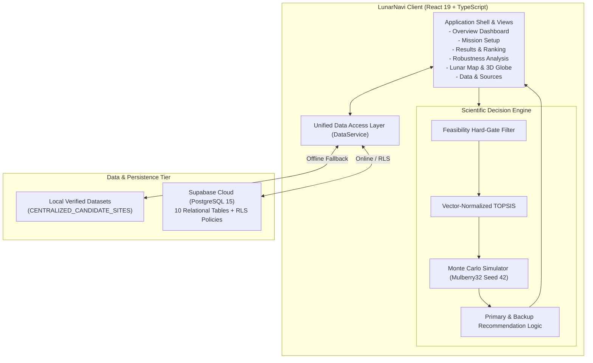

# LunarNavi — System Architecture & Design Specification

> **Comprehensive Technical Architecture, Subsystem Boundaries, Data Flows, and Service Contracts.**

---

## 1. System Overview

**LunarNavi** is a mission-aware decision-support platform designed for lunar south pole landing site evaluation. Built to support NASA Artemis and commercial exploration missions, LunarNavi evaluates candidate landing locations against multiple physical, scientific, and operational criteria using authentic NASA planetary geospatial data.

The system combines:
1. **Interactive Cartographic Visualization**: Canvas 2D raster rendering of authentic NASA LOLA elevation, slope, and surface roughness models.
2. **Interactive 3D Moon Globe**: Three.js WebGL globe with authentic surface textures, dynamic terminal lighting, and site markers.
3. **Multi-Criteria Decision Analysis (MCDA)**: Mathematical vector-space evaluation utilizing the Technique for Order Preference by Similarity to Ideal Solution (**TOPSIS**).
4. **Stochastic Uncertainty Quantification**: Deterministic **Monte Carlo simulation** (Mulberry32 PRNG seed 42) across 500 perturbed criteria states to assess site ranking robustness.
5. **Cloud Persistence & Historical Audit Layer**: **Supabase** (PostgreSQL 15) backend providing relational storage for candidate sites, mission profiles, and decision run audit logs, paired with an instant zero-latency local fallback mechanism.

---

## 2. Frontend Subsystems

The frontend is implemented in **React 19** with **TypeScript** and bundled via **Vite 6.2**.

### Core Application Views

1. **Mission Setup View (`src/frontend/views/MissionSetup.tsx`)**:
   - Mission configuration interface focused on 3 required parameters: Mission Purpose (`science`, `resource`, `crewed`, `communication`), Planned Lunar Arrival Date, and Surface Stay Duration.
   - Criteria weights and threshold constraints are automatically mapped and normalized ($\sum w_j = 1.0$).
   - Displays read-only engineering standards and operational boundaries.

2. **Cartographic Lunar Map (`src/frontend/views/LunarMap.tsx`)**:
   - Hardware-accelerated HTML5 Canvas 2D rendering engine.
   - Multi-layer geospatial visualization:
     - Authentic NASA LOLA Digital Elevation Model (DEM) and slope rasters.
     - Dynamic false-color palettes (Viridis, Inferno, Coolwarm, Monochromatic Grayscale).
     - Viewport controls: smooth pan, multi-level zoom, and coordinate crosshair inspection.
   - Candidate site marker overlays with interactive detail modals and direct recommendation links.

3. **3D Lunar Globe (`src/frontend/components/LunarGlobe3D.tsx`)**:
   - Three.js WebGL interactive 3D sphere with authentic lunar surface texture mapping (`moon_surface.jpg`).
   - Dynamic directional lighting simulating the lunar solar vector and sub-solar latitude.
   - Synchronized site pin selection and inspection.

4. **Results & Ranking View (`src/frontend/views/Results.tsx`)**:
   - Primary landing site recommendation card displaying relative closeness ($C_i^*$).
   - Decorrelated backup site recommendation card maximizing geographical and topographical risk diversity.
   - Candidate leaderboard with distance-to-ideal ($S_i^+$) and distance-to-anti-ideal ($S_i^-$).
   - Direct "View on Lunar Map" shortcuts for Primary and Backup sites.

5. **Robustness Analysis View (`src/frontend/views/RobustnessAnalysis.tsx`)**:
   - Complete educational and technical breakdown of TOPSIS and Monte Carlo methodologies.
   - Section 1: TOPSIS general theory (6 mathematical steps) + LunarNavi application matrix.
   - Section 2: Monte Carlo general theory (LLN, PRNG, distributions) + LunarNavi 500-trial sensitivity distribution.

6. **Data & Sources View (`src/frontend/views/DataAndSources.tsx`)**:
   - Authoritative scientific dataset provenance (NASA PDS, LOLA, Diviner, LEND, PGDA).
   - Direct archive links and honest data coverage status tags (`Verified / available`, `Derived from source data`).

---

## 3. Client-Side Computational Engine

A fundamental architectural principle of LunarNavi is executing **100% of mathematical evaluations client-side** in pure TypeScript.

### Rationale for Client-Side Execution

1. **Zero Network Latency**: User interactions with mission profiles or arrival dates re-evaluate feasibility, compute TOPSIS closeness, and execute 500 Monte Carlo iterations in under 150 milliseconds.
2. **Deterministic Reproducibility**: Uses a seeded pseudo-random number generator (**Mulberry32**, seed 42) ensuring identical, reproducible results across any browser or environment without network variance.
3. **Air-Gap Compatibility**: Mission control and defense environments frequently operate in air-gapped networks; client-side execution guarantees complete operational readiness without internet access.
4. **Computational Efficiency**: Evaluates $N=16$ candidate sites across 6 criteria through 500 stochastic trials using vectorized arithmetic in $\approx 130$ ms, well within standard 60 fps rendering thresholds.

---

## 4. Backend & Supabase Service Layer

The application incorporates a decoupled **Supabase** backend layer designed around a resilient service contract.

### Dual-Mode Architecture

- **Online Mode (Supabase Connected)**:
  When `VITE_SUPABASE_URL` and `VITE_SUPABASE_ANON_KEY` are provided, the application connects to Supabase PostgreSQL, reading normalized reference data and writing audit records to `analysis_runs`, `analysis_results`, and `simulation_runs`.
- **Offline Mode (Local Fallback)**:
  When credentials are not configured, LunarNavi automatically falls back to bundled in-memory TypeScript datasets (`CENTRALIZED_CANDIDATE_SITES`). The application is 100% functional out-of-the-box.

---

## 5. Security & Row Level Security (RLS)

All 10 Supabase PostgreSQL tables are protected by Row Level Security:
- **Reference Tables** (`data_sources`, `dataset_versions`, `lunar_sites`, `criteria`, `site_measurements`, `mission_profiles`, `mission_criteria_weights`): Public Read (`SELECT`) enabled for anonymous and authenticated users. Writes reserved for administrators.
- **Audit Logging Tables** (`analysis_runs`, `analysis_results`, `simulation_runs`): Public Read (`SELECT`) and Anonymous Write (`INSERT`) permitted, allowing sessions to persist without mandatory account registration. `UPDATE` and `DELETE` are disallowed to guarantee an **immutable audit trail**.
